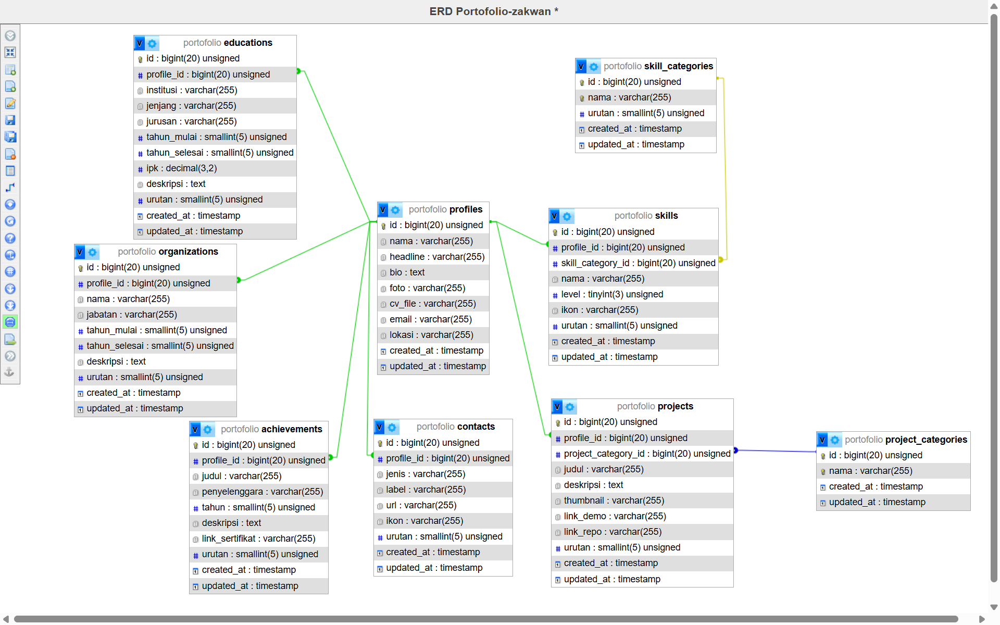

# Portofolio Pribadi: Zakwan Abdurrahman

Website CV dan portofolio pribadi berbasis database. Seluruh konten (profil, pendidikan,
organisasi, skill, pencapaian, proyek, kontak) dibaca dari database, bukan ditulis langsung di view.

## Teknologi

- Laravel 13 (PHP 8.4)
- MySQL / MariaDB
- Blade + Tailwind CSS v4 (Vite)
- Desain dari Figma

## Fitur

- Satu halaman dengan section: Home, About, Resume (pendidikan, organisasi, skill, pencapaian), Projects, Contact
- Timeline pendidikan, grid pengalaman dan pencapaian, skill per kategori
- Filter proyek per kategori
- Tombol Download CV dan tautan sertifikat, semuanya dari database
- Tombol Email membuka jendela tulis Gmail

## Struktur database

| Tabel | Isi |
|---|---|
| `profiles` | nama, headline, bio, foto, cv_file, email, lokasi |
| `educations` | institusi, jenjang, jurusan, tahun, ipk, deskripsi |
| `organizations` | nama, jabatan, tahun, deskripsi |
| `skill_categories` | nama kategori skill |
| `skills` | nama skill, kategori |
| `achievements` | judul, penyelenggara, tahun, link_sertifikat |
| `project_categories` | nama kategori proyek |
| `projects` | judul, deskripsi, thumbnail, link demo dan repo, kategori |
| `contacts` | jenis, label, url |

Kolom `urutan` mengatur urutan tampil tanpa mengubah kode.



## Cara menjalankan

Prasyarat: PHP 8.2+, Composer, Node.js, MySQL (misalnya lewat Laragon).

1. Clone repo dan masuk ke foldernya.
2. Install dependensi:
   ```bash
   composer install
   npm install
   ```
3. Salin file environment dan buat kunci aplikasi:
   ```bash
   copy .env.example .env
   php artisan key:generate
   ```
4. Buat database kosong bernama `portofolio`, lalu atur `.env`:
   ```env
   DB_CONNECTION=mysql
   DB_HOST=127.0.0.1
   DB_PORT=3306
   DB_DATABASE=portofolio
   DB_USERNAME=root
   DB_PASSWORD=
   ```
5. Buat tabel dan isi data awal:
   ```bash
   php artisan migrate --seed
   ```
6. Jalankan (dua terminal):
   ```bash
   npm run dev
   ```
   ```bash
   php artisan serve
   ```
7. Buka http://127.0.0.1:8000

Alternatif: impor `database/portofolio.sql` ke database kosong lewat phpMyAdmin.

Mengubah isi website: edit langsung di tabel database (phpMyAdmin) atau ubah
`database/seeders/PortfolioSeeder.php` lalu jalankan `php artisan migrate:fresh --seed`
(perintah ini menghapus dan membuat ulang seluruh isi database).

## Kredit

- Template desain: **Portfolio Website Design** oleh **Paul Allan Palacio**, https://www.figma.com/community/file/1175755450846438274/portfolio-website-design
- Halaman Resume dan penyesuaian lain dirancang sendiri.
